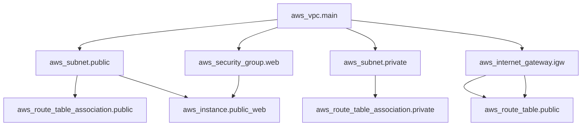

# AWS Networking Mini Project

This mini project introduces a very small AWS network design using Terraform.

The goal is to create:
- one VPC
- two subnets
- one public subnet for internet-facing resources
- one private subnet for internal resources
- one internet gateway
- one public route table
- one private route table
- one security group
- one public EC2 instance

This gives a beginner-friendly foundation for understanding networking in Terraform before moving to more complex infrastructure.

---

## Architecture

```text
Internet
   |
   v
[Internet Gateway]
   |
   v
[VPC 10.0.0.0/16]
   |
   +-------------------+
   |                   |
   v                   v
Public subnet        Private subnet
10.0.1.0/24          10.0.2.0/24
   |                   |
   v                   v
Public EC2 instance   Internal resources
```

This is a common simple network pattern for learning AWS networking.

---

## What we are creating

### 1. VPC
The VPC is the main isolated network boundary.

### 2. Public subnet
This subnet is internet-facing and can host resources such as a public EC2 instance.

### 3. Private subnet
This subnet is intended for internal-only resources that do not need direct internet access.

### 4. Internet gateway
This allows internet access for public-facing resources when the route table allows it.

### 5. Route tables
Public traffic is routed to the internet gateway, while private traffic can remain internal.

### 6. Security group
Controls which ports are exposed to the public instance.

### 7. EC2 instance
A simple public web server helps demonstrate how Terraform provisions an AWS resource inside a subnet.

---

## Example Terraform files

### `main.tf`

```hcl
terraform {
  required_providers {
    aws = {
      source  = "hashicorp/aws"
      version = "~> 6.0"
    }
  }
}

provider "aws" {
  region = var.aws_region
}

resource "aws_vpc" "main" {
  cidr_block = var.vpc_cidr
}

resource "aws_subnet" "public" {
  vpc_id                  = aws_vpc.main.id
  cidr_block              = var.public_subnet_cidr
  map_public_ip_on_launch = true
  availability_zone       = "${var.aws_region}a"
}

resource "aws_subnet" "private" {
  vpc_id            = aws_vpc.main.id
  cidr_block        = var.private_subnet_cidr
  availability_zone = "${var.aws_region}b"
}

resource "aws_internet_gateway" "igw" {
  vpc_id = aws_vpc.main.id
}

resource "aws_security_group" "web" {
  name   = "web-sg"
  vpc_id = aws_vpc.main.id

  ingress {
    from_port   = 22
    to_port     = 22
    protocol    = "tcp"
    cidr_blocks = ["0.0.0.0/0"]
  }

  ingress {
    from_port   = 80
    to_port     = 80
    protocol    = "tcp"
    cidr_blocks = ["0.0.0.0/0"]
  }

  egress {
    from_port   = 0
    to_port     = 0
    protocol    = "-1"
    cidr_blocks = ["0.0.0.0/0"]
  }
}

resource "aws_instance" "public_web" {
  ami                         = data.aws_ami.amazon_linux_2023.id
  instance_type               = var.instance_type
  subnet_id                   = aws_subnet.public.id
  vpc_security_group_ids      = [aws_security_group.web.id]
  associate_public_ip_address = true

  user_data = <<-EOF
              #!/bin/bash
              yum update -y
              yum install -y httpd
              systemctl enable httpd
              systemctl start httpd
              echo "Hello from Terraform mini project" > /var/www/html/index.html
              EOF

  tags = {
    Name = "public-web-instance"
  }
}
```

### `variables.tf`

```hcl
variable "aws_region" {
  type    = string
  default = "us-west-2"
}

variable "vpc_cidr" {
  type    = string
  default = "10.0.0.0/16"
}

variable "public_subnet_cidr" {
  type    = string
  default = "10.0.1.0/24"
}

variable "private_subnet_cidr" {
  type    = string
  default = "10.0.2.0/24"
}

variable "instance_type" {
  type    = string
  default = "t3.micro"
}
```

### `terraform.tfvars.example`

```hcl
aws_region          = "us-west-2"
vpc_cidr            = "10.0.0.0/16"
public_subnet_cidr  = "10.0.1.0/24"
private_subnet_cidr = "10.0.2.0/24"
instance_type       = "t3.micro"
```

This project follows the repo convention where real `*.tfvars` files are ignored by Git, and only `.example` files are committed.

---

## Why this matters

This mini networking setup demonstrates the basic building blocks of AWS networking:
- boundaries: VPC
- segmentation: public and private subnets
- connectivity: internet gateway and routing
- access control: security groups
- compute: EC2 instance in a public subnet

This is the foundation for later labs involving:
- EC2 instances
- ALBs
- NAT gateways
- private workloads
- Kubernetes or ECS clusters

---

## Typical workflow

```bash
terraform init
terraform plan
terraform apply
terraform output
terraform destroy
```

This follows the same lifecycle used throughout the repo.

---

## Learning goals

By the end of this mini project, a learner should be able to explain:
- what a VPC is
- why public and private subnets are separate
- what an internet gateway does
- how route tables control traffic flow
- how security groups protect a public EC2 instance
- how Terraform provisions a basic AWS network and compute setup

---

## Next possible extension

After this project, the next step could be:
- add a NAT gateway for private subnet internet access
- add a second EC2 instance in the private subnet
- add a load balancer in front of the public EC2 instance
- create a full three-tier architecture

---

## Beginner notes: how to read this Terraform file

This project is meant to teach the patterns used in real Terraform code, not just the final result.

### 1. Providers: the AWS connection layer

At the top of the file:

```hcl
terraform {
  required_providers {
    aws = {
      source  = "hashicorp/aws"
      version = "~> 6.0"
    }
  }
}

provider "aws" {
  region = var.aws_region
}
```

This tells Terraform:
- use the AWS provider
- download the AWS plugin
- connect to AWS in the configured region

`provider "aws"` is the connection layer. It does not create infrastructure by itself. It just tells Terraform how to talk to AWS.

---

### 2. Data sources: "look up something already managed by AWS"

This block:

```hcl
data "aws_ami" "amazon_linux_2023" {
  most_recent = true

  filter {
    name   = "name"
    values = ["al2023-ami-2023.*-x86_64"]
  }

  owners = ["amazon"]
}
```

is a data source, not a resource.

A data source is read-only. It asks AWS for information, such as the latest Amazon Linux AMI ID, and then Terraform uses that ID in the EC2 resource.

This is different from a resource block, which creates a new object in AWS.

That is why there is no manual AMI ID written in the file. Terraform queries AWS and gets it dynamically.

---

### 3. Availability zones: why `${var.aws_region}a` and `${var.aws_region}b`?

These lines:

```hcl
availability_zone = "${var.aws_region}a"
availability_zone = "${var.aws_region}b"
```

are choosing AWS availability zones.

For example, if `aws_region = "us-west-2"`, then the values become:
- `us-west-2a`
- `us-west-2b`

AWS regions have multiple isolated data centers called availability zones. Terraform lets you place resources in specific AZs to spread workloads and improve resilience.

These are not invented IDs. They are AWS location names.

---

### 4. Security group ingress: why `tcp` and port 22?

This block:

```hcl
ingress {
  from_port   = 22
  to_port     = 22
  protocol    = "tcp"
  cidr_blocks = ["0.0.0.0/0"]
}
```

means:
- allow inbound traffic
- on port 22
- using the TCP protocol
- from anywhere (`0.0.0.0/0`)

Why not `ssh` as the protocol?
Because in AWS security groups, `protocol` is the transport protocol, not the service name.

SSH is a service that runs over TCP on port 22. So the correct pattern is:
- protocol = `tcp`
- port = `22`

The same idea applies to HTTP:
- protocol = `tcp`
- port = `80`

---

### 5. Egress and `-1`

This block:

```hcl
egress {
  from_port   = 0
  to_port     = 0
  protocol    = "-1"
  cidr_blocks = ["0.0.0.0/0"]
}
```

means:
- allow outbound traffic
- from all ports
- using all protocols
- to anywhere

`-1` is AWS security group syntax for "all protocols". It is the shorthand for unrestricted outbound traffic.

This is common for a simple public EC2 instance in a learning lab.

---

### 6. What is happening in the EC2 `user_data` block?

This section:

```hcl
user_data = <<-EOF
  #!/bin/bash
  yum update -y
  yum install -y httpd
  systemctl enable httpd
  systemctl start httpd
  echo "Hello from Terraform mini project" > /var/www/html/index.html
EOF
```

is a shell script that runs when the EC2 instance boots.

It does the following:
- updates the OS packages
- installs Apache (`httpd`)
- enables and starts the web server
- writes a simple HTML page

This is often called a bootstrap script. It is how Terraform can configure an instance automatically at launch time.

It is not JSON, and you do not manually `jsonencode` it here. Terraform passes the script to EC2, and AWS handles the launch-time execution. Terraform does not need you to manually convert it to JSON in this case.

---

### 7. Why do we use IDs like `aws_vpc.main.id` and `aws_subnet.public.id` if we never wrote them ourselves?

This is a very common beginner question.

The answer is: AWS generates these IDs automatically when the resource is created.

For example:
- `aws_vpc.main.id` is the ID of the VPC created by Terraform
- `aws_subnet.public.id` is the ID of the subnet created by Terraform
- `aws_security_group.web.id` is the SG ID created by AWS
- `aws_instance.public_web.public_ip` is the public IP assigned to the EC2 instance

Terraform does not expect you to invent these IDs. It gets them from AWS after creation and stores them as attributes that can be referenced elsewhere.

That is why the file can say:

```hcl
subnet_id = aws_subnet.public.id
vpc_security_group_ids = [aws_security_group.web.id]
```

Terraform knows the value from the dependency graph and the actual AWS resource created earlier in the same plan.

This is the core magic of Terraform: it connects resource references automatically.

---

### 8. The big idea

The file is a series of declarations:
- define the provider
- ask AWS for a useful AMI
- create a VPC
- create subnets
- attach an internet gateway
- create a security group
- launch an EC2 instance
- expose the important values as outputs

Terraform handles the dependency ordering for you.

The AWS-generated IDs are not missing; they are created dynamically at apply time and then referenced by Terraform automatically.

---

## Resource dependency diagram



This is the dependency chain in plain English:
- the VPC must exist before the subnets
- the internet gateway attaches to the VPC
- the public route table uses the internet gateway
- the public subnet is associated with the public route table
- the security group is created inside the VPC
- the EC2 instance is launched inside the public subnet and uses the security group

---

## What gets created in what order?

Terraform does not always create resources in the order they appear in the file. It uses a dependency graph.

The rough order here is:

1. `aws_vpc.main` creates the VPC
2. `aws_subnet.public` and `aws_subnet.private` are created inside that VPC
3. `aws_internet_gateway.igw` is attached to the VPC
4. `aws_route_table.public` and `aws_route_table.private` are created
5. subnet-to-route-table associations are linked
6. `aws_security_group.web` is created in the VPC
7. `aws_instance.public_web` is created in the public subnet and uses the security group

Terraform figures this out automatically because resources reference each other through attributes such as:

```hcl
vpc_id = aws_vpc.main.id
subnet_id = aws_subnet.public.id
vpc_security_group_ids = [aws_security_group.web.id]
```

This is why Terraform is often described as dependency-aware.

---
