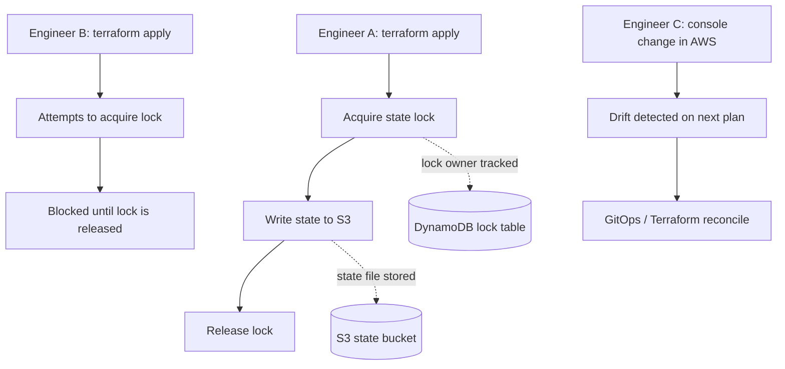

# Terraform State and Remote Backend with S3

Terraform state is the source of truth for the infrastructure Terraform manages.

When you run `terraform apply`, Terraform records the current state of your resources in a state file. That file tells Terraform what exists, what attributes are currently set, and what resources are tracked.

## Why state matters

State is important because it lets Terraform:
- know what it created previously
- compare the current configuration with the real infrastructure 
- decide what needs to change
- calculate drift and plan updates
- manage dependencies between resources

Without state, Terraform would not know what it owns.

---

## Local state vs remote state

Historically, state files were often stored locally:

```text
terraform.tfstate
```

This works for learning, but it has major drawbacks:
- easy to lose or overwrite
- difficult to share across engineers
- no central locking mechanism
- risk of collisions in team environments

A better pattern is a remote backend, often using:
- S3 for the state file
- DynamoDB for state locking

This makes state more durable and safer for teams.

---

## The classic S3 + DynamoDB pattern

A common remote backend setup is:

- S3 bucket for the Terraform state file
- DynamoDB table for state locking

This gives you:
- centralized state storage
- versioning/history for the state file
- protection against concurrent writes
- a stronger team workflow for infrastructure changes

## Why DynamoDB used to be part of the old pattern

Earlier Terraform workflows often used DynamoDB as a lock table for the state file.

This was designed to prevent two engineers from applying changes at the same time.

If two people run `terraform apply` at once, they can both read the same state and accidentally overwrite each other’s changes. The lock table helps stop that.

In the old pattern, the lock owner was effectively the active Terraform process holding the lock, and the lock prevented other runs from writing to the same state.

---

## State locking concept

State locking means Terraform ensures only one process can modify state at a time.

This is crucial in team environments because:
- one engineer may be writing to the same infrastructure at the same time as another
- if both apply at once, the second run may overwrite or conflict with the first
- team coordination becomes error-prone without locking

The lock records who owns the lock and prevents concurrent writes.

In a remote backend, this lock ownership is usually tracked by the backend and may be represented by a lock ID, lease, or lock session managed by the backend system.

---

## Drift

Drift means the real resources in AWS no longer match what Terraform expects.

Example:

An engineer changes a resource in the AWS console directly.

Terraform state still says one thing, but the actual cloud resource is now different.

This creates drift.

Examples of drift:
- a security group is edited manually in the console
- a bucket policy is changed outside Terraform
- a VPC tag is modified manually
- someone deletes a resource without Terraform

When drift happens:
- `terraform plan` will show differences
- Terraform compares the real world to the state file and configuration
- the state file is not automatically updated by the console change
- the state is a record of the last known desired state, not the live reality

That is why drift detection is so important.

---

## Who owns the state?

In a team, the state file is effectively the shared record of infrastructure ownership.

The practical rule is:
- Terraform state is the system of record for managed resources
- engineers should not make manual changes without updating the IaC workflow
- any direct console changes should be treated as drift and reconciled

This means:
- if an engineer edits a resource in AWS, they are creating drift
- unless that change is intentionally made through Terraform, the next plan will show it

---

## Example: 3 engineers and shared state

Imagine a small team of three DevOps engineers:

- Engineer A: adds a new subnet
- Engineer B: updates a route table
- Engineer C: changes a security group

If they all run Terraform separately against the same state file, there can be conflicts.

With a remote backend:
- the state is stored centrally in S3
- DynamoDB prevents two writes at the same time
- each run must acquire the lock before applying
- the lock owner is tracked, and others must wait

This is how state locking protects a team from overlapping changes.

---

## GitOps and reconciling state

GitOps means changes are driven from version control.

Typical flow:

1. engineer edits Terraform code in Git
2. a CI/CD pipeline runs `terraform plan`
3. a human reviews the diff
4. the pipeline applies changes
5. the backend state is updated
6. future runs reconcile the infrastructure against Git

This helps keep the repository as the source of truth and reduces the chance of manual drift.

If someone changes a resource in the console:
- Git still shows the intended state from code
- Terraform sees drift during the next plan
- the engineering team can reconcile the state by either:
  - updating Terraform to match the real resource, or
  - restoring the resource to the desired IaC state

This is where GitOps helps: it provides a disciplined path to reconcile drift with code, instead of ad hoc console edits.

---

## Example backend pattern

A typical remote backend setup looks like this:

```hcl
terraform {
  backend "s3" {
    bucket         = "my-terraform-state-bucket"
    key            = "dev/network/terraform.tfstate"
    region         = "us-west-2"
    dynamodb_table = "terraform-locks"
    encrypt        = true
  }
}
```

This means:
- the state file is stored in S3
- the lock table is in DynamoDB
- the state is protected and centralized

---

## Practical reminder for this repo

For learning labs, local state is fine for a single engineer.

For team workflows, remote state is the right pattern.

The bigger lesson is:
- state is the record of what Terraform manages
- remote state makes team operations safer
- state locking prevents overlapping writes
- drift is what happens when the real world deviates from Terraform state
- GitOps gives teams a disciplined way to reconcile those differences

---

## Three-engineer workflow example



What this shows:
- Engineer A starts a Terraform apply and acquires the lock
- Engineer B cannot write at the same time because the lock is owned
- Engineer C changes something manually in AWS and creates drift
- the next plan reveals the mismatch, and GitOps is used to reconcile it

This is the same reason state locking and remote backends matter in real team workflows.

---

## Summary

- state files track what Terraform owns
- local state is convenient but weak for teams
- S3 + DynamoDB remote backend is the classic safer pattern
- DynamoDB historically handled state locking
- lock ownership prevents concurrent writes
- drift happens when console changes happen outside Terraform
- GitOps helps reconcile real-world drift with the desired code state
